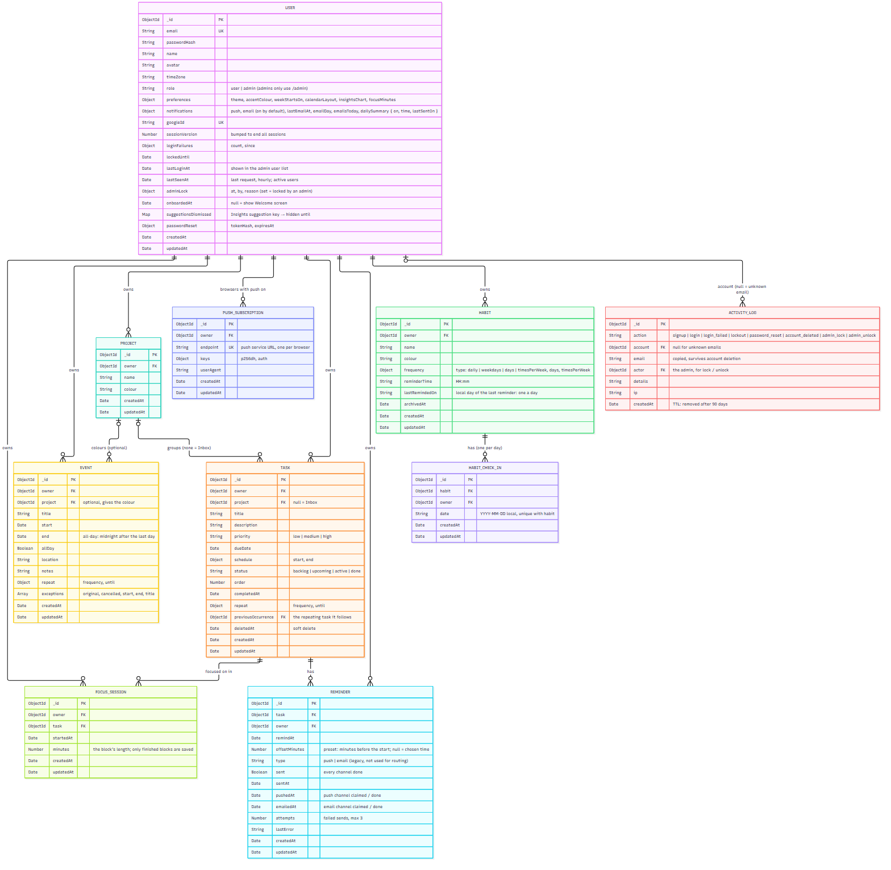

# Agendal

[](https://github.com/khang-ngo4444/VCD_Agendal/actions/workflows/ci.yml)

Agendal is a personal productivity and task management web application developed as the final project for **Advanced Web Design**.

The application helps users organize tasks, manage projects, schedule activities, track habits, and monitor their productivity from one centralized workspace.

## Project Overview

Managing tasks, schedules, projects, and personal routines across multiple applications can be inconvenient. Users may need one application for calendars, another for task lists, and another for tracking long-term goals.

Agendal combines these functions into one simple productivity platform. Users can create tasks, organize them into projects, schedule work, track habits, receive reminders, and review their progress through statistics.

The application is designed around the following core features:

- Personal user accounts
- Task and project management
- Habit tracking
- Calendar-based scheduling
- Reminders and notifications
- Productivity statistics
- Search and filtering
- Administration tools

## Main Features

### User Accounts

Users can:

- Register for an account
- Log in and log out
- Reset a forgotten password
- Change their password
- Manage their personal profile
- Configure their preferred theme and interface settings
- Delete their account and associated data

Each user's tasks, habits, and categories are kept separate from other users.

### Task Management

Users can create and manage personal tasks with the following information:

- Title
- Description
- Due date and time
- Priority
- Category
- Colour
- Completion status
- Reminder time
- Recurrence settings

Tasks can be:

- Created with only a title
- Edited
- Marked as complete
- Reopened
- Soft deleted
- Restored after deletion
- Searched and filtered
- Repeated daily, weekly, or monthly

### Project and Category Organization

Tasks can be grouped using categories and projects. Users can:

- Create categories
- Rename categories
- Assign colours to categories
- Filter tasks by category
- View the number of completed and incomplete tasks
- Organize related tasks under a common goal

Tasks without a selected category are placed in a default Inbox category.

### Habit Tracking

Agendal allows users to create and track habits.

Users can:

- Create a habit
- Set a target frequency
- Record daily check-ins
- View their current streak
- View their longest streak
- Monitor their completion rate
- Track progress over time

Example habits include:

- Exercise every day
- Read three times per week
- Review notes every weekday
- Practice a skill weekly

### Calendar

The calendar provides day, week, and month views for scheduled tasks and habit check-ins.

Users can:

- View scheduled tasks by date and time
- Create a task by selecting a date
- Review upcoming work
- Identify busy periods
- Reschedule tasks
- View tasks using their category colours

### Statistics Dashboard

The dashboard provides an overview of a user's productivity, including:

- Today's tasks
- Weekly completion rate
- Monthly completion rate
- Habit streaks
- Completion progress
- Tasks grouped by category
- Productivity trends

Users can export their tasks and habit check-ins as CSV files.

### Reminders and Notifications

Users can create reminders for tasks and habits.

Reminders may be sent through email or web notifications, depending on the configured application services.

The reminder system supports:

- Reminders for scheduled tasks
- Custom reminder dates and times
- Habit reminders
- Background processing through queued jobs
- Daily task summaries

### Search and Filtering

Users can quickly find tasks by searching for keywords in their title or description.

Tasks can also be filtered by:

- Keyword
- Category
- Priority
- Completion status
- Due date
- Date range

Search results show relevant task information such as the title, category, priority, and due date.

### Administration

Administrators can access a separate administration area to:

- View users
- Lock or unlock user accounts
- Review basic system statistics
- Monitor application activity

Only users with administrator privileges can access administrative features.

## Technologies

| Area | Technology |
| :--- | :--- |
| Frontend | EJS |
| Styling | Tailwind CSS |
| UI Components | DaisyUI |
| Backend | Node.js and Express.js |
| Architecture Style | MVC |
| Database | MongoDB |
| Version Control | Git and GitHub |
| Design | Figma |
| Continuous Integration | GitHub Actions |
| Container Registry | GitHub Container Registry |

## System Architecture

Agendal follows a server-side rendered web application architecture.

The main components are:

1. **Client Interface**
   - EJS templates
   - Tailwind CSS
   - DaisyUI components
   - Responsive layouts for desktop and mobile browsers

2. **Express.js Application**
   - Handles routing
   - Processes authentication
   - Validates requests
   - Provides application services
   - Renders EJS pages
   - Manages access control

3. **MongoDB Database**
   - Stores users
   - Stores tasks and categories
   - Stores habits and check-ins
   - Stores reminders

4. **Background Jobs**
   - Process reminders
   - Generate recurring tasks
   - Send email notifications

5. **Administration Module**
   - Displays system statistics
   - Restricts administrative actions to authorized users

### Relationships

- A user can have many tasks.
- A user can have many categories.
- A category can contain many tasks.
- A user can have many habits.
- A habit can have many check-ins.
- A task or habit can have reminders.

### Database ERD



The diagram is generated from [`docs/erd.mmd`](docs/erd.mmd); the re-render command is at the top of that file.

## Security

The application includes the following security measures:

- Passwords are hashed before storage.
- User data is isolated by account.
- Protected routes require authentication.
- Administrative routes require administrator privileges.
- User input is validated before processing.
- Database queries are restricted to authorized users.
- Sensitive configuration values are stored in environment variables.
- HTTPS should be used when deploying the application.
- Login attempts should be protected against brute-force attacks.

## Performance and Reliability

Agendal is designed with the following goals:

- Main pages should load quickly on a typical broadband connection.
- Task creation should provide immediate feedback.
- Search results should appear without unnecessary delay.
- Database queries should use indexes where appropriate.
- Frequently accessed data may be cached.
- Background work should be processed asynchronously.
- Errors should be logged for debugging and monitoring.

## Project Structure

A possible project structure is:

```text
.
├── app.js
├── package.json
├── package-lock.json
├── .env.example
├── config/
├── controllers/
├── middleware/
├── models/
├── routes/
├── services/
├── jobs/
├── validators/
├── views/
│   ├── layouts/
│   ├── auth/
│   ├── tasks/
│   ├── habits/
│   ├── calendar/
│   ├── dashboard/
│   └── admin/
├── public/
│   ├── css/
│   ├── js/
│   └── images/
├── tests/
└── README.md
```

## Development Flow

This project follows **Git Flow** to maintain a structured development process and keep the production-ready codebase stable.

### Branches

| Branch | Purpose |
|---|---|
| `main` | Contains stable, production-ready code. |
| `feature/<name>` | Develops new features. Branched from `develop` and merged back into `develop`. |
| `task/<name>` | Handles small tasks, improvements, refactoring, or non-feature work. Branched from `develop` and merged back into `develop`. |
| `hotfix/<name>` | Fixes critical production issues. Branched from `main` and merged back into both `main` and `develop`. |

### Workflow

1. **Create a branch:** Create a `feature/<name>` or `task/<name>` branch from `develop` for each feature or task.
2. **Develop and commit:** Make changes on the dedicated branch using clear, descriptive commit messages.
3. **Submit a Pull Request:** Open a PR targeting `develop` when the work is complete. Review and test changes before merging.
4. **Plan a release:** Create a GitHub Milestone for each planned release (e.g., `v1.0.0`). Assign the relevant issues and tasks to the milestone and track their progress.
5. **Release:** Once the milestone's required work is complete and tests pass, merge `develop` into `main` through a Pull Request. Tag the release commit (e.g., `v1.0.0`) and publish a GitHub Release.
6. **Handle hotfixes:** For urgent production issues, create a `hotfix/<name>` branch from `main`. Merge the fix into both `main` and `develop`.

### Branch Naming Convention

Use lowercase names with hyphens to separate words.

```text
main
develop
feature/user-authentication
feature/dashboard-ui
task/update-dependencies
task/refactor-api
hotfix/login-error
```

### Rules

- Never commit directly to `main` or `develop`; use Pull Requests.
- Keep each feature or task branch focused on a single objective.
- Ensure changes pass the relevant tests before merging.
- Delete merged feature and task branches after integration.
- Use semantic versioning (`MAJOR.MINOR.PATCH`) for releases where applicable.
- Use GitHub Milestones to organize and track work planned for each release.
- Use Git tags to identify release commits on `main`.
- Keep `main` stable and deployable at all times.

### Branch Overview

```text
main
 ├── hotfix/login-error
 └── develop
      ├── feature/user-authentication
      ├── feature/dashboard-ui
      └── task/update-dependencies
```

Feature and task branches merge into `develop`. When a milestone is ready for release, merge `develop` into `main` and tag the release. Hotfixes originate from `main` and are merged into both `main` and `develop`.

## Configure Environment Variables

Create a `.env` file based on `.env.example`.

Example configuration:

```env
PORT=3000
NODE_ENV=development

MONGODB_URI=mongodb://127.0.0.1:27017/agendal

SESSION_SECRET=replace-with-a-secure-secret

MAIL_HOST=
MAIL_PORT=
MAIL_USERNAME=
MAIL_PASSWORD=
```

Do not commit the `.env` file to the repository.

## Running the Tests

```bash
npm test                   # every test
npm run test:unit          # tests/unit only: fast, no database
npm run test:integration   # tests/integration only: real requests and a database
```

```text
tests/
├── helpers/http.js        shared setup for the integration tests
├── unit/                  no database: calculations, validators, services with fakes
│   ├── account/           sign-up rules, sessions, account deletion
│   ├── admin/             admin console data, users, activity log
│   ├── calendar/          calendar layout, events, repeating dates
│   ├── focus/             focus sessions
│   ├── habits/            frequencies, streaks, the habit form
│   ├── insights/          statistics, CSV export
│   ├── reminders/         task and habit reminders, daily summary, email and push
│   ├── shared/            dates and time zones
│   └── tasks/             the task form, Board columns, search
└── integration/           the whole app through HTTP
```

- **Unit tests** check one module at a time, with no database. Put a new one in the folder of its feature.
- **Integration tests** send real requests to the app (Supertest) against a throwaway in-memory MongoDB (`mongodb-memory-server`), so your own database is never touched. They cover sign-up, login and lockout, the main task flows, habit check-ins and streaks, data isolation between accounts and the admin-only routes.
- The first integration run downloads a MongoDB binary (about 100 MB); later runs reuse it.
- `npm test` and `npm run test:integration` run Jest with `--experimental-vm-modules`, because the MongoDB driver loads `os` with a dynamic `import()` that Jest only allows with that flag.

**CI:** GitHub Actions (`.github/workflows/ci.yml`) builds the CSS and runs `npm test` on every pull request into `develop` or `main`. To make a green run required before merging, turn on branch protection for `develop` and `main` (Settings › Branches) and require the **CI / test** check.

## Project Scope

### In Scope

- User registration and authentication
- User profiles and settings
- Task creation and management
- Task priorities and due dates
- Categories and project organization
- Recurring tasks
- Habit tracking
- Calendar views
- Productivity statistics
- Reminders
- Search and filtering
- Administration dashboard
- Database migrations and seed data
- Automated testing
- GitHub Actions CI

### Out of Scope

- Advanced artificial intelligence features
- Large-scale production deployment
- Native mobile applications
- Complex enterprise project management features
